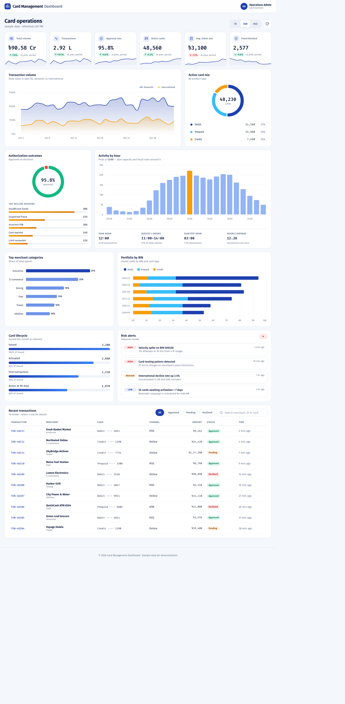

# Card Management Dashboard

A card analytics and operations dashboard for the Bangladesh market. It shows portfolio, transaction and risk metrics in one responsive screen, with amounts in BDT (৳) using lakh/crore formatting.

> The app runs entirely on generated sample data. There is no backend, no real-time feed and no deployment target; it is a front-end showcase.



## Features

- **KPI cards** for volume, transactions, approval rate, active cards, average ticket and fraud blocked, each with a sparkline and change vs the previous period
- **Charts** for transaction volume, card mix, authorization outcomes, activity by hour, merchant categories and portfolio by BIN
- **Insights** such as top decline reasons, a card lifecycle funnel and risk alerts
- **Recent transactions** table with product type (for example Platinum Credit or Gift Prepaid), a masked card number (`5061 ******** 4821`), status filter and search by merchant, ID, card or product. Select a row to open a details dialog (amount, product type, response code, authorization code, fee, net amount and a status timeline)
- **Date range** switch (7D / 30D / 90D)
- **Responsive** from 320px phones to wide desktops: the table becomes a card list and the dialog becomes a bottom sheet on small screens
- **Accessible**: keyboard navigation, visible focus, labelled controls, chart accessibility module, and `prefers-reduced-motion` support
- **Motion**: staggered reveal, count-up numbers, animated charts and progress bars

## Tech stack

Angular 19 (standalone components, lazy-loaded route), Highcharts 12 via `highcharts-angular`, SCSS. No UI framework; styling uses CSS variables and a small set of design tokens (Fira Sans / Fira Code, blue and amber).

## Getting started

Requires Node.js 18+ and npm.

```bash
npm install
npm start        # http://localhost:4200
```

| Command | Purpose |
|---|---|
| `npm start` | Development server |
| `npm run build` | Production build into `dist/card-management-dashboard` |
| `npm test` | Unit tests (Karma + Jasmine, needs Chrome) |

## Project structure

```
src/app
├── app.*                         Shell: top bar, router outlet, footer
├── pages/dashboard
│   ├── dashboard.ts|html|scss    Page component and styles
│   ├── dashboard.data.ts         Seeded sample data, BDT formatting, card masking, transactions
│   ├── dashboard.charts.ts       Highcharts option builders
│   └── *.spec.ts                 Unit tests
└── shared/count-up.directive.ts  Animated number directive
```

## Notes

- Sample data is seeded, so every range renders the same numbers on each load. Transaction times are relative to when the page loads.
- Currency uses `en-IN` digit grouping to produce the lakh/crore style (for example `৳1,37,280`).
- Only the BIN and the last four digits of a card are stored. `maskCard` shows the first four and last four digits and masks the rest for a 16-digit card (for example `5061 ******** 4821`); pass a different length for other card sizes.
